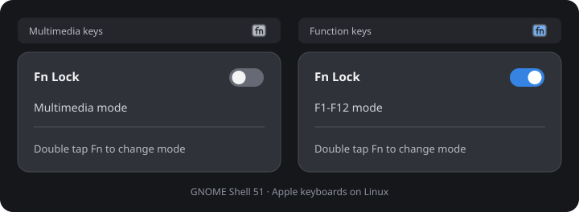

# MacBook Fn Lock

[](https://github.com/ThibaudP/macbook-fn-lock/actions/workflows/check.yml)
[](LICENSE)

Double-tap **Fn** to switch between multimedia keys and **F1–F12** on your MacBook running Linux. A compact GNOME panel icon shows the current mode, and its menu lets you switch with a click.



*Interface illustration. The menu follows your GNOME theme.*

| Mode | Press a top-row key | Hold Fn + top-row key | Icon |
| --- | --- | --- | --- |
| **Multimedia mode** | Volume, brightness, playback… | F1–F12 | Neutral |
| **F1-F12 mode** | F1–F12 | Volume, brightness, playback… | Blue |

- **Double-tap Fn** or use the **Fn Lock** switch.
- The menu stays open when you change modes.
- Your selected mode is restored after reboot.
- Fn+arrows and Fn+Backspace keep their usual behavior.
- No keyboard grabbing, replacement key events, or typed-text logging.

## Compatibility

The current release targets **GNOME Shell 51** on Linux, including Wayland. The desktop and service have been checked on a **MacBookPro10,2 with Ubuntu 26.10**. Other GNOME versions and MacBook models have not been verified yet.

Your keyboard must use the kernel's **`hid_apple`** driver and expose **`KEY_FN`**. Keyboards that hide Fn in their firmware cannot provide the double-tap gesture. This does not target macOS or keyboards using a different driver.

Dependencies: Python 3, PyGObject (`python3-gi` on Ubuntu), systemd, D-Bus, polkit, and administrator access to install the system service. If PyGObject is missing on Ubuntu:

```sh
sudo apt install python3-gi
```

## Install

Run the installer as your normal desktop user:

```sh
git clone https://github.com/ThibaudP/macbook-fn-lock.git
cd macbook-fn-lock
./install.sh
```

The installer uses sudo for the system service and installs the extension for your user. The **extension ZIP alone is not sufficient**: the service is required for the keyboard gesture and mode changes.

Alternatively, extract the complete source archive from a [GitHub release](https://github.com/ThibaudP/macbook-fn-lock/releases), enter its directory, and run `./install.sh`.

### Activate without logging out

GNOME may not discover a new extension immediately, and an upgrade keeps the previous JavaScript loaded until it is reloaded. To apply the installed files now:

1. Press **Alt+F2**, enter **`lg`**, and press Enter.
2. In **Evaluator**, run the following, replacing `/absolute/path/to/macbook-fn-lock` with the checkout or extracted source directory:

   ```js
   await (await import('file:///absolute/path/to/macbook-fn-lock/scripts/reload-in-shell.js')).reload()
   ```

3. Press **Escape** to close Looking Glass.

This helper keeps the session running and does not enable D-Bus evaluation. You can instead log out and back in, then run:

```sh
gnome-extensions enable apple-fn-lock@thibaudp.github.io
```

### Use

Look for the small **fn** key icon in the top bar. Its menu contains:

```text
Fn Lock                                  [switch]
Multimedia mode / F1-F12 mode
────────────────────────────────────────────────
Double tap Fn to change mode
```

For the gesture, complete two short taps within **500 ms**. Holding Fn, pressing another key on the same keyboard, or typing between taps cancels it. An amber icon indicates an unavailable service or driver; the menu displays the reason.

### Update

From a Git checkout:

```sh
git pull --ff-only
./install.sh
```

Then reload using Looking Glass as above, or log out and back in.

## Uninstall

Run from the checkout or extracted source directory:

```sh
./uninstall.sh
```

This removes the service, extension, D-Bus and polkit configuration, and saved state. It restores the kernel Fn mode recorded before the service's first run. Installation does not modify modprobe configuration or rebuild the initramfs.

## How it works

A small system service observes Apple keyboard events through evdev and switches `/sys/module/hid_apple/parameters/fnmode` between **1** (multimedia first) and **2** (F1–F12 first). It recognizes Fn taps and cancels gestures when another key is involved. Individual key events and typed text are not recorded, logged, or exported.

The extension reads mode changes from the service over D-Bus. Its only control operation is `SetLocked(bool)`, authorized by polkit for an active local session. Users do not need general access to input devices or permission to write kernel settings.

Disconnects and dropped events reset gesture detection. Apple keyboards are rediscovered within about two seconds. The kernel setting applies to **all keyboards handled by `hid_apple`**. The service continues recognizing the gesture when the GNOME extension is disabled; stop `apple-fn-lock.service` to turn it off entirely.

## Troubleshooting

```sh
systemctl status apple-fn-lock.service
journalctl -u apple-fn-lock.service -b
cat /sys/module/hid_apple/parameters/fnmode
gnome-extensions info apple-fn-lock@thibaudp.github.io
```

- **No panel icon:** activate or reload the extension using the instructions above.
- **Service unavailable:** check `systemctl status apple-fn-lock.service` and its journal.
- **Keyboard not detected:** verify that the keyboard uses `hid_apple` and exposes `KEY_FN`. The menu switch may still change the driver's mode.
- **Gesture follows the Control key:** `hid_apple.swap_fn_leftctrl=1` swaps the physical Fn and left Control keys. Keep it at `0` if you want the physical Fn key.

Report compatibility results or problems in [GitHub Issues](https://github.com/ThibaudP/macbook-fn-lock/issues).

## Development

```sh
./scripts/check.sh
python3 scripts/package.py
```

`make check` and `make package` are equivalent if Make is installed. Checks require Python with PyGObject and GJS. Tests use temporary state files, synthetic events, and simulated Shell widgets; they do not access the keyboard or change its mode. A live GNOME session is still needed to verify appearance and interaction.

Packages are written to `dist/`: a versioned source archive, a GNOME extension ZIP, and `SHA256SUMS`. The explicit [MANIFEST](MANIFEST) controls source archive contents, so unlisted local files and caches are excluded.

See [CONTRIBUTING.md](CONTRIBUTING.md) for development and release instructions and [CHANGELOG.md](CHANGELOG.md) for release history.

References: [Linux hid-apple driver](https://code.googlesource.com/linux/torvalds/linux/+/7acf90feab8b009fde7def08ff2c622d0f10e99f/drivers/hid/hid-apple.c), [GNOME extension documentation](https://gjs.guide/extensions/), [polkit documentation](https://www.freedesktop.org/software/polkit/docs/latest/polkit.8.html).

## License

[MIT](LICENSE), © 2026 Thibaud Poncin.
